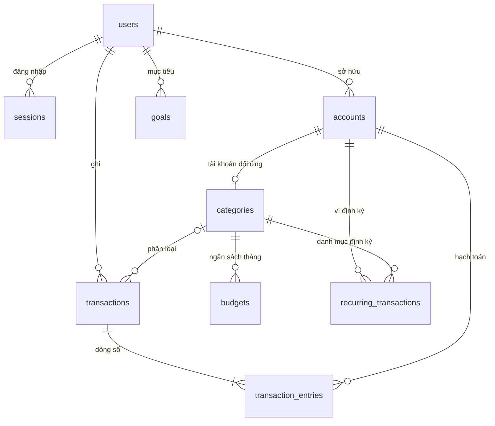

# Database và backend

## Cài đặt

Yêu cầu Node.js 20.9+, MySQL 8+ hoặc MariaDB 10.4+. XAMPP đã kèm MariaDB; bật nút MySQL trong XAMPP Control Panel. Hướng dẫn chạy từng bước nằm ở [README chính](../README.md).

`.env.local` giữ cấu hình ứng dụng và credentials setup, được Git bỏ qua. `DB_USER` phải là tài khoản riêng, không phải root, có mật khẩu không rỗng. `DB_SETUP_USER` chỉ dùng bởi CLI để tạo database/user và bảng. Script không đổi mật khẩu hoặc quyền của user đã có; nếu dùng user có sẵn, quản trị viên phải cấp quyền DML trên database tương ứng trước.

`npm.cmd run db:setup` áp dụng `schema.sql` và các migration đã khai báo trong script, ghi checksum trong `schema_migrations` và không chạy lại phiên bản đã áp dụng. Migration 002 thêm trigger thu hồi mọi session khi một user bị khóa (`blocked=true`); mở khóa không khôi phục các session cũ. MySQL DDL tự commit: nếu lần đầu bị lỗi giữa chừng, kiểm tra nguyên nhân và các bảng đã tạo trước khi tiếp tục; script chủ động dừng khi phát hiện bảng `users` không có migration, không xóa bảng để thử lại. Thay đổi schema đã áp dụng cần migration mới.

## Mô hình dữ liệu



| Bảng | Vai trò |
| --- | --- |
| `users` | Tài khoản email/số điện thoại chuẩn hóa, tên, mật khẩu băm scrypt, vai trò và trạng thái |
| `sessions` | SHA-256 của token ngẫu nhiên, người dùng và hạn dùng 7 ngày; không lưu token gốc |
| `accounts` | Ví và tài khoản đối ứng thu/chi; hiện giới hạn VND |
| `categories` | Danh mục thu hoặc chi, gắn với một tài khoản sổ cái |
| `transactions` | Loại, số tiền, ngày, ghi chú, danh mục và khóa chống gửi trùng |
| `transaction_entries` | Hai dòng tiền có dấu đối ứng của mỗi giao dịch |
| `budgets` | Hạn mức theo danh mục/tháng; schema nền tảng |
| `goals` | Tên, số tiền đích, hạn; chưa có phân bổ tiền/tiến độ |
| `recurring_transactions` | Quy tắc định kỳ; chưa có scheduler phát sinh giao dịch |
| `exchange_rates` | Tỷ giá theo ngày; chưa áp dụng quy đổi đa tiền tệ |
| `schema_migrations` | Phiên bản và checksum schema đã áp dụng |

Khóa ngoại ghép `(user_id, id)` giữ tài khoản, danh mục và dòng sổ trong cùng một người dùng. Tất cả API đọc/ghi đều lấy user từ session phía server; client không được chọn `user_id` hay vai trò khi đăng ký.

## Quy tắc sổ kép

Số tiền lưu bằng `DECIMAL(14,2)`, nhập dưới dạng chuỗi thập phân dương, tối đa `999999999999.99`. Không tính dòng hạch toán bằng số dấu phẩy động. Số dư ví được tính bằng tổng dòng sổ, không duy trì một cột số dư riêng.

| Nghiệp vụ | Dòng 1 | Dòng 2 |
| --- | --- | --- |
| Thu 1.000.000đ | Ví +1.000.000 | Tài khoản thu -1.000.000 |
| Chi 50.000đ | Ví -50.000 | Tài khoản chi +50.000 |
| Chuyển 200.000đ | Ví nguồn -200.000 | Ví nhận +200.000 |

Backend ghi header và hai dòng trong cùng database transaction, khóa ví theo thứ tự ổn định và rollback nếu có lỗi. Tổng dòng của mỗi giao dịch bằng 0. Chuyển tiền bị loại khỏi tổng thu/chi và biểu đồ danh mục. Không sửa/xóa giao dịch qua API hiện tại. Số dư âm được cho phép vì đây là sổ ghi chép, không phải hệ thống chi trả.

Ràng buộc tổng nhiều dòng được bảo đảm ở hàm ghi sổ và kiểm thử tích hợp; không ghi SQL thủ công vào sổ cái để bỏ qua nghiệp vụ này. Số tiền đầu vào và lưu trữ là decimal chính xác; biểu đồ hiển thị dùng JavaScript Number, không dùng để ghi sổ. Chưa có nghiệp vụ số dư đầu kỳ độc lập; ví mới bắt đầu từ 0.

## API đã triển khai

API ghi chỉ nhận JSON, yêu cầu header `Origin` khớp `APP_ORIGIN`. Cookie phiên là HttpOnly, SameSite=Lax; đặt Secure khi dùng HTTPS. Tất cả API tài chính cần đăng nhập.

| Method | Endpoint | Nội dung |
| --- | --- | --- |
| POST | `/api/auth/register` | `{name, account, password}`; băm mật khẩu, tạo ví và danh mục mặc định, không tự đăng nhập |
| POST | `/api/auth/login` | `{account, password}`; tạo session cookie |
| POST | `/api/auth/logout` | `{}`; xóa session phía server và cookie |
| GET | `/api/auth/me` | Người dùng hiện tại hoặc `null` |
| GET/POST | `/api/wallets` | Danh sách và số dư / thêm ví `{name}` số dư 0 |
| GET/POST | `/api/categories` | Danh sách / thêm `{name, kind: income\|expense}` |
| POST | `/api/transactions` | Ghi sổ kép |
| GET | `/api/finance?start=YYYY-MM-DD&end=YYYY-MM-DD&q=...` | Tổng thu/chi, lịch sử, thống kê danh mục và ngân sách đã có dữ liệu |

Ví dụ body ghi giao dịch:

```json
{
  "kind": "expense",
  "walletId": "UUID-của-ví",
  "categoryId": "UUID-danh-mục-chi",
  "amount": "50000.00",
  "bookedOn": "2026-10-14",
  "note": "Ăn trưa",
  "requestKey": "UUID-v4-duy-nhất"
}
```

Chuyển tiền dùng `kind=transfer`, `targetId` là ví nhận, không cần `categoryId`. Khóa `requestKey` trùng trả HTTP 409 và không ghi lần hai. Form giữ khóa khi chưa rõ kết quả do lỗi mạng; gặp 409 thì kiểm tra lịch sử trước khi ghi lại. Lịch sử trả tối đa 200 giao dịch gần nhất trong kỳ; tổng và thống kê vẫn tính toàn kỳ. Khoảng truy vấn tối đa 366 ngày. Ngày nghiệp vụ là `DATE`, ngày mặc định theo múi giờ Việt Nam; session hết hạn theo UTC.

Đăng nhập có giới hạn 15 lượt/tài khoản/15 phút trong một tiến trình. Khi triển khai nhiều instance cần kho giới hạn dùng chung; chưa có xác minh email/điện thoại, khôi phục mật khẩu, Google OAuth hoặc quản lý khóa tài khoản qua API. `/admin` yêu cầu vai trò admin nhưng nội dung hiện có vẫn là bản mẫu, chưa thực hiện backup hay đồng bộ tỷ giá.

## Kiểm thử

```powershell
npm.cmd run lint
npx.cmd tsc --noEmit
npm.cmd run build
npm.cmd run test:integration
npm.cmd run test:browser
```

Integration runner cần MySQL đang chạy và credentials `DB_SETUP_*`. Nó tạo database/user có tên ngẫu nhiên `cnpm_test_*`/`cnpm_t_*`, chạy server riêng trên cổng trống, kiểm tra auth/CSRF/quyền sở hữu, tiền thập phân, chống trùng, chuyển tiền, ghi đồng thời, rollback khi dòng thứ hai lỗi, báo cáo, setup chạy lại và các trang. Sau cùng chỉ dọn đúng tài nguyên thử nghiệm đã tạo. Không dùng database `cnpm_524` để ghi dữ liệu test.

`test:browser` chạy thêm quy trình đăng ký, đăng nhập, ghi thu/chi/chuyển tiền, xem số dư/báo cáo và đăng xuất bằng Playwright. Trên Windows dùng Microsoft Edge đã cài sẵn; trên Linux cần chạy `npx playwright install chromium` một lần. Kiểm tra cả form rỗng và chiều rộng màn hình điện thoại 390px.

Có thể kiểm tra thủ công sau đăng nhập: thu 1.000.000đ vào Tiền mặt, chi 50.000đ, chuyển 200.000đ sang Ngân hàng. Số dư phải là 750.000đ và 200.000đ; tổng thu 1.000.000đ và tổng chi 50.000đ. Đăng xuất rồi đăng nhập lại để xác nhận dữ liệu vẫn còn.
