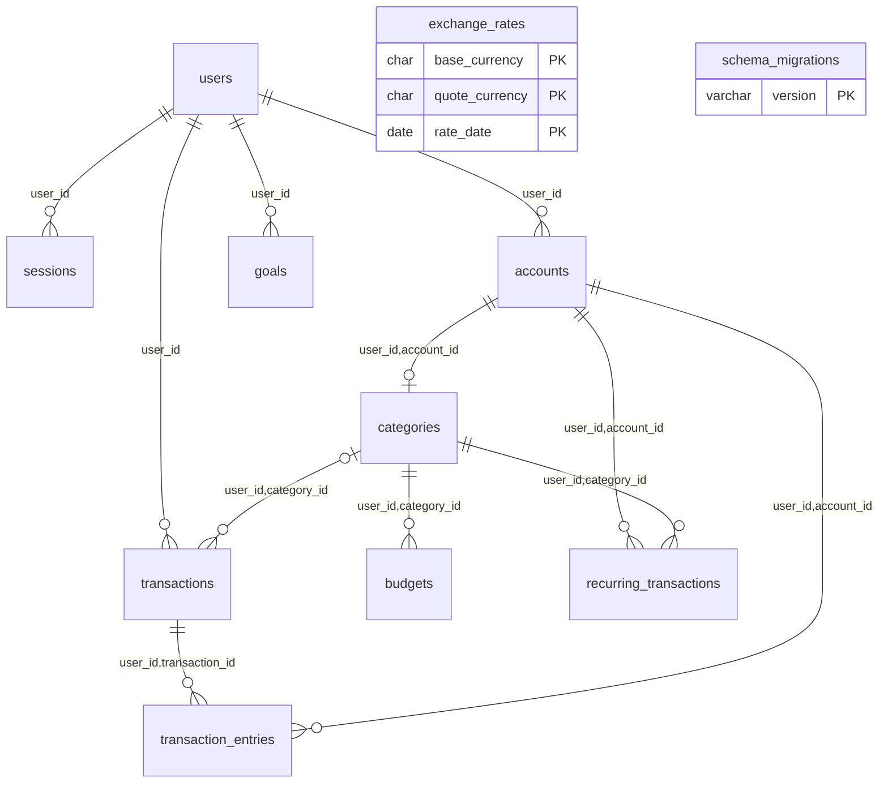

# Từ điển dữ liệu và ERD hiện có

Nguồn: origin/main `7e47d999411209f165e803d0addf3346e357917a` đã được kéo về main; cùng phiên bản với HEAD đang mở. Đây là đối chiếu mã, chưa kết nối cơ sở dữ liệu để xác nhận các bảng đã được tạo.

ERD thể hiện 10 bảng nghiệp vụ trong schema.sql và bảng kỹ thuật schema_migrations trong script setup. Không có khóa ngoại cho exchange_rates hoặc schema_migrations.

## Quan hệ bảng từ schema hiện tại

Xem [ERD trực quan trong HTML](index.html#erd) hoặc mở [sơ đồ SVG](erd.svg). Sơ đồ thể hiện đầy đủ các cột; bảng bên dưới bổ sung chi tiết kiểu dữ liệu và ràng buộc.

## Quy tắc phải giữ khi thiết kế

- accounts là tài khoản sổ cái: wallet, income, expense, equity. Ví là tập con kind=wallet; mỗi danh mục gắn một tài khoản đối ứng duy nhất.
- transaction_entries.amount là số có dấu; tổng hai dòng mỗi giao dịch được hàm postTransaction ghi bằng 0. SQL không có CHECK tổng nhiều dòng và không ép một giao dịch luôn có đúng hai dòng.
- Vì SQL chỉ có FK, ERD vật lý ghi transactions 1 — 0..N transaction_entries; luồng nghiệp vụ hiện ghi đúng hai dòng trong cùng transaction DB.
- Khóa ngoại ghép (user_id, id) giữ tài khoản, danh mục và dòng sổ cùng chủ. user_id trong budgets/categories/recurring/entries không phải FK trực tiếp tới users; quyền sở hữu được ràng buộc qua các FK ghép.
- categories.account_id UNIQUE: một account có 0 hoặc 1 category, mỗi category có đúng 1 account. Bảng accounts không chỉ chứa ví.
- transactions.category_id NULL cho transfer; bắt buộc có danh mục cho income/expense. Chuyển tiền không tính vào tổng thu/chi.
- Không có wallet_id/target_id trong transactions: ví nguồn và ví nhận được biểu diễn qua transaction_entries. Các tên walletId/targetId là trường đầu vào API.
- Số dư ví là SUM(transaction_entries.amount), không có cột balance riêng.
- Hiện accounts và transactions bị CHECK currency=VND. exchange_rates chưa được gắn FK vào giao dịch hoặc dùng để ghi sổ đa tiền tệ.
- budgets: UNIQUE(user_id, category_id, month_start), số tiền >0 và ngày phải là đầu tháng. API chỉ cho danh mục expense của chính người dùng.
- goals chưa có số tiền đã tích lũy hoặc bảng phân bổ; không thể suy ra tiến độ mục tiêu từ target_amount.
- sessions lưu token_hash, không lưu token thô. users.password_hash là mật khẩu đã băm; chưa có trường 2FA trong schema.
- Không tự thêm khóa users tới categories/budgets/recurring/entries vào ERD vật lý khi schema không khai báo FK đó.
- Không sửa schema gốc đã áp dụng; thay đổi thiết kế cơ sở dữ liệu cần migration mới.

## users — Người dùng

Nguồn: [schema của dự án](../../database/schema.sql).

| Cột | Kiểu SQL | Khóa và NULL |
|---|---|---|
| id | `CHAR(36)` | PK, NOT NULL |
| name | `VARCHAR(100)` | NOT NULL |
| account | `VARCHAR(190)` | UNIQUE, NOT NULL |
| password_hash | `VARCHAR(255)` | NOT NULL |
| role | `ENUM('user', 'admin')` | NOT NULL |
| blocked | `BOOLEAN` | NOT NULL |
| created_at | `TIMESTAMP` | NOT NULL |

## sessions — Phiên đăng nhập

Nguồn: [schema của dự án](../../database/schema.sql).

| Cột | Kiểu SQL | Khóa và NULL |
|---|---|---|
| token_hash | `CHAR(64)` | PK, NOT NULL |
| user_id | `CHAR(36)` | tham gia FK, NOT NULL |
| expires_at | `DATETIME` | NOT NULL |
| created_at | `TIMESTAMP` | NOT NULL |

FK `(user_id)` → `users(id)` ON DELETE CASCADE.

## accounts — Ví và tài khoản sổ cái

Nguồn: [schema của dự án](../../database/schema.sql).

| Cột | Kiểu SQL | Khóa và NULL |
|---|---|---|
| id | `CHAR(36)` | PK, NOT NULL |
| user_id | `CHAR(36)` | tham gia FK, NOT NULL |
| name | `VARCHAR(100)` | NOT NULL |
| kind | `ENUM('wallet', 'income', 'expense', 'equity')` | NOT NULL |
| currency | `CHAR(3)` | NOT NULL |
| created_at | `TIMESTAMP` | NOT NULL |

UNIQUE ghép hoặc đơn: `(user_id, id)`.

UNIQUE ghép hoặc đơn: `(user_id, name)`.

FK `(user_id)` → `users(id)` ON DELETE CASCADE.

## categories — Danh mục thu/chi

Nguồn: [schema của dự án](../../database/schema.sql).

| Cột | Kiểu SQL | Khóa và NULL |
|---|---|---|
| id | `CHAR(36)` | PK, NOT NULL |
| user_id | `CHAR(36)` | tham gia FK, NOT NULL |
| account_id | `CHAR(36)` | tham gia FK, NOT NULL |
| name | `VARCHAR(100)` | NOT NULL |
| kind | `ENUM('income', 'expense')` | NOT NULL |

UNIQUE ghép hoặc đơn: `(user_id, id)`.

UNIQUE ghép hoặc đơn: `(user_id, kind, name)`.

UNIQUE ghép hoặc đơn: `(account_id)`.

FK `(user_id, account_id)` → `accounts(user_id, id)` ON DELETE CASCADE.

## transactions — Đầu giao dịch

Nguồn: [schema của dự án](../../database/schema.sql).

| Cột | Kiểu SQL | Khóa và NULL |
|---|---|---|
| id | `CHAR(36)` | PK, NOT NULL |
| user_id | `CHAR(36)` | tham gia FK, NOT NULL |
| kind | `ENUM('income', 'expense', 'transfer')` | NOT NULL |
| amount | `DECIMAL(14,2)` | NOT NULL |
| currency | `CHAR(3)` | NOT NULL |
| booked_on | `DATE` | NOT NULL |
| note | `VARCHAR(500)` | NOT NULL |
| category_id | `CHAR(36)` | tham gia FK, NULL |
| request_key | `CHAR(36)` | NOT NULL |
| created_at | `TIMESTAMP` | NOT NULL |

UNIQUE ghép hoặc đơn: `(user_id, id)`.

UNIQUE ghép hoặc đơn: `(user_id, request_key)`.

FK `(user_id)` → `users(id)` ON DELETE CASCADE.

FK `(user_id, category_id)` → `categories(user_id, id)`; không khai báo CASCADE.

## transaction_entries — Dòng sổ kép có dấu

Nguồn: [schema của dự án](../../database/schema.sql).

| Cột | Kiểu SQL | Khóa và NULL |
|---|---|---|
| id | `BIGINT` | PK, NOT NULL |
| user_id | `CHAR(36)` | tham gia FK, NOT NULL |
| transaction_id | `CHAR(36)` | tham gia FK, NOT NULL |
| account_id | `CHAR(36)` | tham gia FK, NOT NULL |
| amount | `DECIMAL(14,2)` | NOT NULL |

UNIQUE ghép hoặc đơn: `(transaction_id, account_id)`.

FK `(user_id, transaction_id)` → `transactions(user_id, id)` ON DELETE CASCADE.

FK `(user_id, account_id)` → `accounts(user_id, id)`; không khai báo CASCADE.

## budgets — Ngân sách tháng

Nguồn: [schema của dự án](../../database/schema.sql).

| Cột | Kiểu SQL | Khóa và NULL |
|---|---|---|
| id | `CHAR(36)` | PK, NOT NULL |
| user_id | `CHAR(36)` | tham gia FK, NOT NULL |
| category_id | `CHAR(36)` | tham gia FK, NOT NULL |
| month_start | `DATE` | NOT NULL |
| amount | `DECIMAL(14,2)` | NOT NULL |

UNIQUE ghép hoặc đơn: `(user_id, category_id, month_start)`.

FK `(user_id, category_id)` → `categories(user_id, id)`; không khai báo CASCADE.

## goals — Mục tiêu tài chính

Nguồn: [schema của dự án](../../database/schema.sql).

| Cột | Kiểu SQL | Khóa và NULL |
|---|---|---|
| id | `CHAR(36)` | PK, NOT NULL |
| user_id | `CHAR(36)` | tham gia FK, NOT NULL |
| name | `VARCHAR(100)` | NOT NULL |
| target_amount | `DECIMAL(14,2)` | NOT NULL |
| due_on | `DATE` | NULL |

FK `(user_id)` → `users(id)` ON DELETE CASCADE.

## recurring_transactions — Quy tắc định kỳ

Nguồn: [schema của dự án](../../database/schema.sql).

| Cột | Kiểu SQL | Khóa và NULL |
|---|---|---|
| id | `CHAR(36)` | PK, NOT NULL |
| user_id | `CHAR(36)` | tham gia FK, NOT NULL |
| account_id | `CHAR(36)` | tham gia FK, NOT NULL |
| category_id | `CHAR(36)` | tham gia FK, NOT NULL |
| amount | `DECIMAL(14,2)` | NOT NULL |
| next_due_on | `DATE` | NOT NULL |
| frequency | `ENUM('weekly', 'monthly', 'yearly')` | NOT NULL |
| enabled | `BOOLEAN` | NOT NULL |

FK `(user_id, account_id)` → `accounts(user_id, id)`; không khai báo CASCADE.

FK `(user_id, category_id)` → `categories(user_id, id)`; không khai báo CASCADE.

## exchange_rates — Tỷ giá dự phòng

Nguồn: [schema của dự án](../../database/schema.sql).

| Cột | Kiểu SQL | Khóa và NULL |
|---|---|---|
| base_currency | `CHAR(3)` | PK, NOT NULL |
| quote_currency | `CHAR(3)` | PK, NOT NULL |
| rate_date | `DATE` | PK, NOT NULL |
| rate | `DECIMAL(20,8)` | NOT NULL |

## schema_migrations — Theo dõi migration

Nguồn: [script setup của dự án](../../scripts/setup-database.mjs).

| Cột | Kiểu SQL | Khóa và NULL |
|---|---|---|
| version | `VARCHAR(100)` | PK, NOT NULL |
| checksum | `CHAR(64)` | NOT NULL |
| applied_at | `TIMESTAMP` | NOT NULL |

